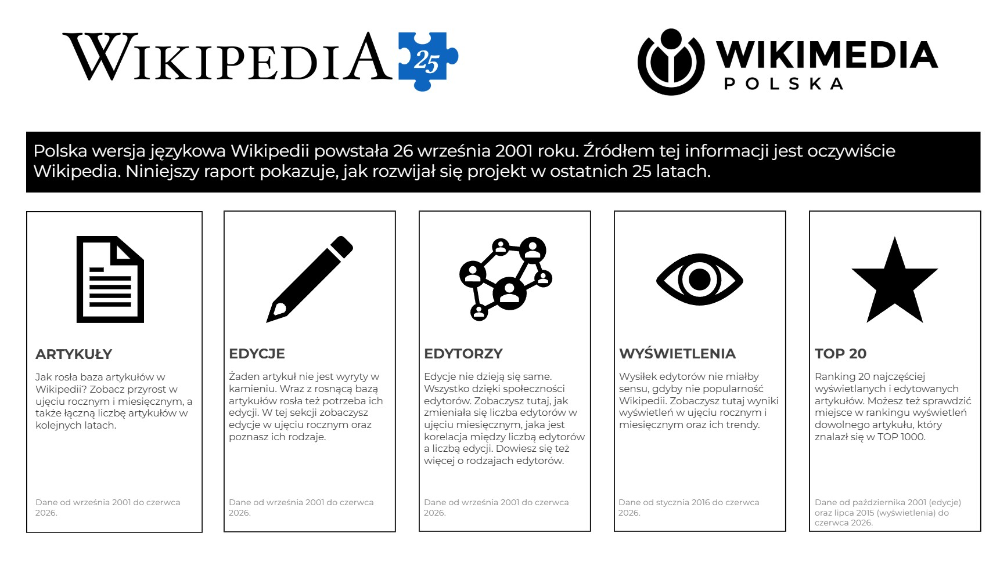

# POLISH WIKIPEDIA ANNIVERSARY

Power BI report prepared for the contest organised by #BI_NGO (Business Intelligence for NGO) and Wikimedia Polska to commemorate the 25th anniversary of Polish Wikipedia.

**Report link:** [25 Years of Wikipedia](https://app.powerbi.com/view?r=eyJrIjoiZTFlZGJlNGMtNDMzMy00MWE3LTk2NDktMjRmMzFjNDg1NWNjIiwidCI6ImQwMzYzN2RmLTdiM2EtNDU2NC04NzBiLTA2MjJhODFhNzY0ZCJ9)

The report is in Polish, as the contest was dedicated to Polish Wikipedia

Data for the report was partly provided by the organisers and partly extracted from Wikistats.

**Technologies used:** Power Query, Power BI

